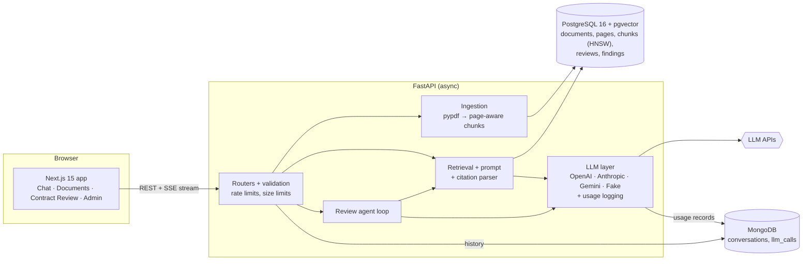
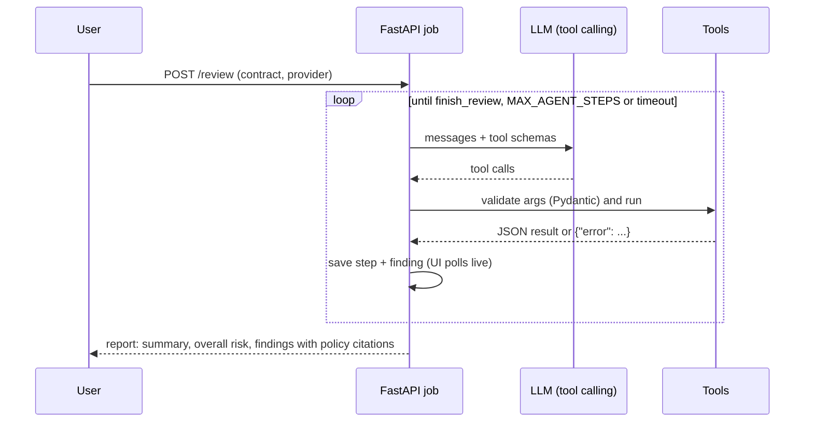

# PolicyPilot

**An AI compliance copilot that answers questions from your policy PDFs with page-level citations, reviews contracts against those policies with a tool-calling agent, and tracks the cost of every LLM call.**

[](https://github.com/SanchitSlayer/policypilot/actions/workflows/backend.yml)
[](https://github.com/SanchitSlayer/policypilot/actions/workflows/frontend.yml)


**Live demo:** _coming soon (Cloud Run)_ · **Walkthrough video:** _coming soon_ · [Deployment guide](docs/DEPLOY.md) · [Demo script](docs/DEMO_SCRIPT.md)

<!-- Demo GIF: record with docs/DEMO_SCRIPT.md, save as docs/demo.gif, then uncomment:

-->

Compliance, operations and legal teams spend hours searching regulations (KYC directions, lending guidelines, internal SOPs) and checking vendor contracts against them. PolicyPilot puts those documents behind a chat that **only answers from the uploaded text and cites the exact document and page**, says plainly when the documents don't cover a question, and runs a **contract review agent** that goes clause by clause and produces an auditable compliance checklist.

## Features

- **Cited answers (RAG)**: upload PDFs; answers stream token by token with inline `[1]` markers that link to the document, page and passage. Unsupported citations are removed, and questions the documents don't cover get "I couldn't find this in the uploaded documents" instead of a guess.
- **Three LLM providers, one switch**: OpenAI, Anthropic Claude or Google Gemini per request, behind one provider interface (chat, streaming and tool calling), plus an offline Fake provider for development and tests.
- **Contract Review agent**: a tool-calling loop (`list_contract_clauses` → `search_policies` → `record_finding` → `finish_review`) that marks every clause compliant, non-compliant or needs-review with reasons and policy citations, shows its progress live, and exports JSON or Markdown.
- **Usage dashboard**: every LLM and embedding call is logged (tokens, latency, estimated cost, errors, prompt version); the Admin page shows requests per day, p50/p95 latency and cost per provider.
- **Conversation history** in MongoDB, with citations, reopenable from the chat sidebar.
- **Production basics**: per-client rate limits, request size limits, security headers, PII redaction in logs, non-root multi-stage images, secrets in Secret Manager, keyless CI/CD deploys.

## Architecture



**Request path for a chat question:** embed the question → cosine search in pgvector (top 6 above a similarity threshold, optionally limited to chosen documents) → prompt the selected provider with numbered sources → stream tokens over Server-Sent Events → parse `[n]` markers into citations → store the turn and the usage record in MongoDB.

## How the RAG works

| Step | What happens | Why |
| --- | --- | --- |
| Extract | `pypdf` reads each page; whitespace is cleaned; empty pages are skipped; page text is stored | Every chunk must know its page for citations; clause splitting needs clean pages |
| Chunk | ~500-token windows with 80-token overlap (tiktoken), **never crossing a page boundary** | Each chunk has exactly one page number |
| Embed | Batched through an `EmbeddingProvider` (OpenAI `text-embedding-3-small` by default) | Model and dimension come from env vars |
| Index | pgvector column with an **HNSW** index on cosine distance | Fast approximate nearest-neighbour search inside Postgres |
| Retrieve | Top-k (6) chunks from ready documents above a minimum similarity; short follow-ups are searched with the previous question | Drops irrelevant context; keeps follow-ups on topic |
| Prompt | Versioned prompt (`rag-v1`): sources as `[1] Title, p.N: text`; answer **only** from them; cite every claim; a fixed sentence when the answer isn't there | Grounded, auditable answers; refusals are machine-checkable |
| Cite | Markers like `[2]` / `[1, 3]` are parsed, mapped to document/page/snippet; numbers that don't match a source are stripped | The UI never shows a citation to a source that doesn't exist |

## How the contract review agent works



- **Tools**: `list_contract_clauses` (numbered headings, sub-clauses, or paragraph fallback), `search_policies` (policy documents only; each passage gets a stable source id like `S2`), `record_finding` (status, reason, source ids), `finish_review` (summary).
- **Guardrails**: arguments validated with Pydantic and errors returned to the model so it can correct itself; unknown tools, unknown clause ids and **citations to passages the agent never retrieved are rejected**; `non_compliant` requires a citation; `finish_review` is refused while clauses are missing; a step cap (`MAX_AGENT_STEPS`, 25) and a timeout; up to two nudges if the model stops early; any clause still without a finding is marked `needs_review` with the reason.
- **Overall risk**: high if any clause is non-compliant, medium if any needs review, otherwise low.
- Works with OpenAI, Anthropic and Gemini tool calling (including Gemini's thought signatures across turns).

## Evaluation

[`eval/run_eval.py`](eval/run_eval.py) runs 47 questions (41 with an expected document and page, 6 the documents don't answer) through `/chat`; before each run it verifies every question's evidence phrase against the ingested chunk of its page. See [eval/README.md](eval/README.md).

| Run | Hit@1 | Hit@3 | MRR | Citation accuracy | No-answer accuracy | Avg latency |
| --- | --- | --- | --- | --- | --- | --- |
| Offline baseline: fake embeddings + Fake LLM | 68.3% | 82.9% | 0.761 | 82.9% | 16.7% | 19 ms |
| OpenAI / Claude / Gemini with `text-embedding-3-small` | _pending_ | | | | | |

The baseline only shows the pipeline works end to end (its embeddings are hashed bag-of-words and its "LLM" answers whenever anything is retrieved). Real-provider rows will be filled in with `make eval PROVIDERS="openai anthropic gemini"`.

## Run locally

Requirements: Docker (Compose v2) and `make`. No API keys are needed to try it: choose **Fake (offline)** in the provider menu.

```bash
git clone https://github.com/SanchitSlayer/policypilot.git && cd policypilot
cp .env.example .env      # add API keys later for real models
make up                   # Postgres + pgvector, MongoDB, API (:8000), web app (:3000)
make seed                 # fictional demo policies and a vendor contract with 5 planted problems
```

Open http://localhost:3000 (API docs at http://localhost:8000/docs). `make help` lists every command.

### Configuration

All settings are environment variables (see [`.env.example`](.env.example)); the most important:

| Variable | Default | Purpose |
| --- | --- | --- |
| `OPENAI_API_KEY`, `ANTHROPIC_API_KEY`, `GEMINI_API_KEY` | empty | Provider keys; a provider without a key returns a clear 400 |
| `OPENAI_CHAT_MODEL`, `ANTHROPIC_CHAT_MODEL`, `GEMINI_CHAT_MODEL` | see `.env.example` | Model per provider |
| `DEFAULT_LLM_PROVIDER` | `fake` | Used when a request names no provider |
| `EMBEDDING_PROVIDER`, `EMBEDDING_MODEL`, `EMBEDDING_DIM` | `openai`, `text-embedding-3-small`, `1536` | Embeddings (`fake` works offline); re-seed with `make seed FORCE=1` after changing |
| `DATABASE_URL`, `MONGO_URL` | local compose services | Connection strings |
| `CHUNK_SIZE_TOKENS`, `CHUNK_OVERLAP_TOKENS` | `500`, `80` | Chunking |
| `RETRIEVAL_TOP_K`, `RETRIEVAL_MIN_SCORE` | `6`, `0.2` | Retrieval |
| `MAX_AGENT_STEPS`, `AGENT_TIMEOUT_SECONDS` | `25`, `300` | Review agent limits |
| `RATE_LIMIT_CHAT`, `RATE_LIMIT_REVIEW`, `RATE_LIMIT_UPLOAD` | `20/minute`, `5/minute`, `10/minute` | Per-client limits |
| `CORS_ORIGINS` | `["http://localhost:3000"]` | Allowed web origins |

Estimated costs come from the editable price table [`backend/config/pricing.yaml`](backend/config/pricing.yaml).

## Testing and CI

```bash
make test     # backend: 104 pytest tests, ~94% line coverage · frontend: 28 Vitest tests
make lint     # ruff (lint + format), ESLint, tsc
```

- Backend tests need no API keys: they use fake embeddings and a scripted fake LLM, and run against real Postgres + pgvector and MongoDB (`policypilot_test` databases). The provider adapters are tested against stub OpenAI, Anthropic and Gemini clients.
- GitHub Actions run on every pull request: [backend](.github/workflows/backend.yml) (ruff, migrations, pytest with coverage against pgvector and MongoDB service containers) and [frontend](.github/workflows/frontend.yml) (ESLint, tsc, Vitest, production build).

## Deployment

Google Cloud Run: two services (API, web app), migration and seed jobs, images in Artifact Registry, keys in Secret Manager, Postgres on Neon (pgvector) and MongoDB Atlas. Tagged releases deploy through [GitHub Actions](.github/workflows/deploy.yml) with Workload Identity Federation (no stored keys). Step-by-step commands and the database trade-offs are in [docs/DEPLOY.md](docs/DEPLOY.md).

## Project structure

```
backend/
  app/
    api/          routers: documents, chat (SSE), review, conversations, admin, health
    core/         settings, databases, rate limits, security middleware, log redaction
    llm/          provider interface + OpenAI / Anthropic / Gemini / Fake, prompts, pricing, usage logging
    models/       SQLAlchemy models (documents, pages, chunks, reviews, findings)
    schemas/      Pydantic request/response models
    services/     ingestion, chunking, retrieval, citations, chat, agent + tools, clauses, usage stats
    scripts/      ingest_folder, seed, make_sample_data
  alembic/        migrations (pgvector, HNSW index, reviews)
  config/         pricing.yaml
  tests/          104 tests
frontend/src/
  app/            Chat, Documents, Contract Review, Admin pages
  components/     chat, documents, review, admin (Recharts), ui
  hooks/ lib/     typed API client, SSE parser, formatting
eval/             test set + evaluation runner
deploy/ docs/     Cloud Build config, deployment guide, demo script
sample_data/      fictional demo policies and contract
```

## Design decisions

- **Page-aware chunks over larger windows**: citations at page granularity matter more to compliance users than slightly richer context per chunk.
- **pgvector instead of a separate vector database**: documents, chunks, reviews and vectors share one transactional store; HNSW keeps search fast at this scale.
- **MongoDB for logs and history**: append-heavy, schema-flexible records with one aggregation pipeline (`$facet`, `$percentile`) for the dashboard.
- **Own provider abstraction instead of a framework**: three SDKs normalised into one message, tool-call and usage shape keeps the agent loop provider-independent and every call loggable in one place.
- **Deterministic fakes everywhere**: the whole app, including the agent, runs and is tested offline.

## Future improvements

- Hybrid search (BM25 + vectors) and a re-ranking step for exact clause numbers and defined terms
- Authentication and multi-tenant workspaces (per-team documents, roles, audit log)
- OCR for scanned PDFs (today they are reported as having no extractable text)
- Background jobs on Cloud Tasks so long reviews survive instance scale-down
- Clause-level comparison against previous contract versions

## License

No license yet; all rights reserved by the author.
